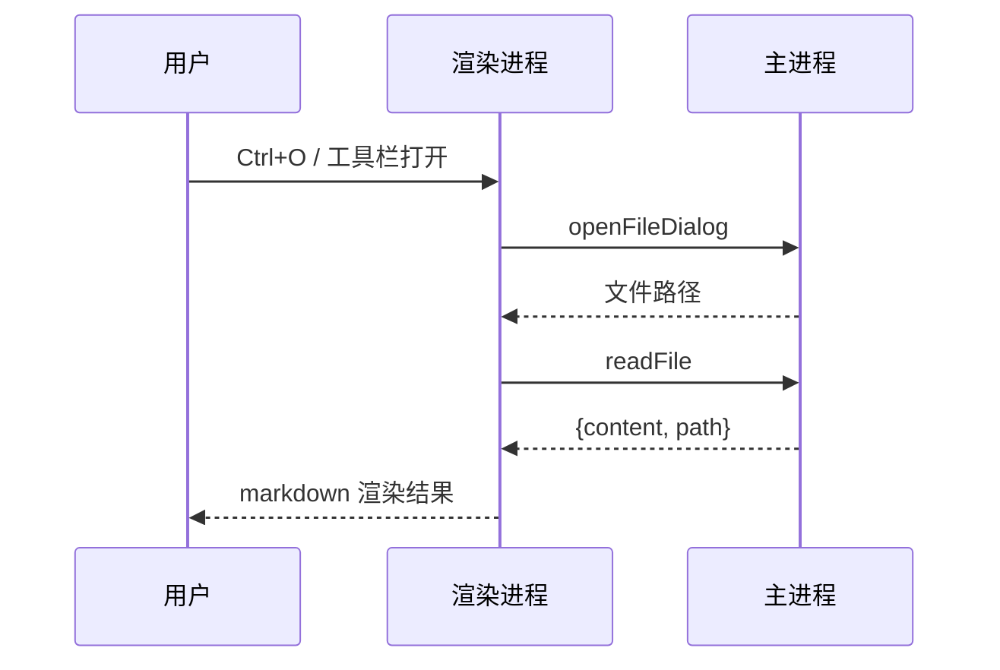

# MDReader 全功能验收文档

> 本文档覆盖当前版本支持的全部渲染能力，每次改动后可用作回归验收。
> 各节标注适用里程碑：M1 基础 / M2-1 高亮 / M2-2 图片 / 1.0.1 批次 1（编码、链接）。
> 新增内容支持时必须同步补上对应章节（项目约定）。

## 1. 标题层级（M1）

# 一级标题（文档首部已用）

## 二级标题

### 三级标题

#### 四级标题

##### 五级标题

###### 六级标题

## 2. 行内样式（M1）

- **粗体** 与 __粗体__
- *斜体* 与 _斜体_
- ***粗斜体***
- ~~删除线~~
- `行内代码 const answer = 42;`
- 转义测试：\*不是斜体\*、\`不是代码\`、\#\# 不是标题
- 链接：[GitHub 风格链接](https://github.com) 与自动链接 https://example.com（点击行为见第 12 节：复制链接，不打开）
- 原始 HTML 应被转义：<script>alert(1)</script> <b>不是加粗</b>

## 3. 列表（M1）

无序与有序嵌套：

- 第一层
  - 第二层
    - 第三层
- 第二项

1. 有序第一项
2. 有序第二项
   1. 嵌套有序
   2. 嵌套有序

任务列表（M2-6 起渲染为复选框，勾选态只读）：

- [ ] 未完成任务
- [x] 已完成任务
- [ ] 另一项未完成

## 4. 表格（M1）

| 对齐方式 | 左对齐 | 居中 | 右对齐 |
|:---------|:-------|:----:|-------:|
| 默认     | 单元格 | 单元格 | 单元格 |
| 中文列   | 排版   | 检查   | 间距   |

## 5. 引用（M1）

> 一层引用：稳 > 花哨。
>
> > 二层嵌套引用：离线、零依赖、启动效率优先。

## 6. 代码高亮（M2-1）

```javascript
// 关键字/字符串/注释/箭头函数
const sum = (a, b) => a + b;
class Reader {
  constructor(name) { this.name = name; }
}
```

```python
import math

def hypot(a: float, b: float) -> float:
    """直角三角形斜边"""
    return math.sqrt(a * a + b * b)
```

```sql
SELECT id, title FROM documents
WHERE status = 'published' AND deleted_at IS NULL
ORDER BY updated_at DESC
LIMIT 10;
```

```bash
# 启动开发环境
pnpm install
pnpm start
```

未注册语言安全降级：

```notalanguage
plain content ~~not deleted~~ **not bold**
```

## 7. 图片（M2-2）

相对路径（应显示）：


`..` 回溯与中文空格文件名（应显示）：


损坏引用（裂图但不影响后续）：


## 8. 分隔线与排版细节（M1）

---

连字符转换（typographer）：普通 "引号" 与 -- 破折号 -- 与 ... 省略号。

超长行自动换行测试：MMMMMMMMMMMMMMMMMMMMMMMMMMMMMMMMMMMMMMMMMMMMMMMMMMMMMMMMMMMMMMMMMMMMMMMMMMMMMMMMMMMMMMMMMMMMMMMMMMMMMMMMMMMMMMMMMMMMMMMMMMMMMMMMMMMMMM

## 9. 数学公式（M2-3 KaTeX）

行内公式：质能方程 $E = mc^2$ 与勾股定理 $a^2 + b^2 = c^2$。

块级公式（独立成行居中显示）：

$$
\int_0^1 x \, dx = \frac{1}{2}
$$

$$
e^{i\pi} + 1 = 0
$$

带下标与分式的混合：$\sum_{i=1}^{n} i = \frac{n(n+1)}{2}$

超宽公式（M2-6：窗口拉窄时应出现横向滚动条，正文版心不被撑破）：

$$
\int_0^\infty x^2 e^{-x}\,dx + \iint_D f(x,y)\,dA + \oint_\Gamma \mathbf{F}\cdot d\mathbf{r} + \lim_{n\to\infty}\left(1+\frac{1}{n}\right)^n + \frac{d}{dx}\left[\sin x\cos x\tan x\sec x\csc x\cot x\right] + \sum_{k=1}^{\infty}\frac{1}{k^2} + \prod_{p \in \mathbb{P}}\frac{1}{1-p^{-2}} > 0
$$

错误公式应显示红色报错原文而非崩溃：

$$
\fra{1}{2}
$$

### 中文公式（KaTeX 无 CJK 字形，经浏览器字体回退显示）

中文写在 `\text{}` 内（规范写法）：$\text{速度} = \frac{\text{路程}}{\text{时间}}$

块级公式 + 中文注释：

$$
\hat{y} = \beta_0 + \beta_1 x_1 + \beta_2 x_2 + \varepsilon \quad \text{（多元线性回归模型）}
$$

中文与符号混排的条件表达：

$$
f(x) = \begin{cases} x^2, & \text{当 } x \geq 0 \\ -x^2, & \text{当 } x < 0 \end{cases}
$$

全文中文的「伪公式」（应能显示，但正常内容不建议这样写）：

$$
\text{明天会更好}
$$

> 目检要点：中文应全部可见（字体回退到系统字体，与公式西文部分风格略有差异属正常）；若出现方框/豆腐块即为回退失败。


## 10. 流程图（M2-4 Mermaid）

流程图（上→下）：


时序图：



错误图（应显示 mermaid 错误图形/提示而非崩溃）：

```mermaid
graph TD
    A[这行语法故意的
    B --> C
```

---

## 11. 文本编码自动探测（1.0.1）

本应用不要求用户统一编码：UTF-8（含 BOM）、UTF-16LE / UTF-16BE，以及记事本
「另存为 ANSI」写出来的 GBK，都应该能直接打开。

下面这条链接指向的样例文件**以 cp936（GBK）编码入库**——用 UTF-8 编辑器打开它会
显示乱码，这是预期行为，用它来验证探测器是否工作：

[打开 GBK 编码样例](./ansi-gbk-sample.md)

| 用例 | 预期表现 |
|:-----|:---------|
| 上面的 GBK 样例 | 中文全部正常显示；打开时出现一次「已按 GB18030/GBK 解码该文档」提示，**位于窗口底部居中、无需滚动即可看到**，数秒后自动消失 |
| 本文件（UTF-8 无 BOM） | 无任何编码提示 |
| UTF-8 带 BOM 的文件 | 无提示，且首行不出现多余的乱码字符 |
| UTF-16 保存的文件 | 中文正常显示，提示「已按 UTF-16LE 解码」 |

> 目检要点：若 GBK 样例中出现 `锟斤拷`、`????`、方框或成片乱码，即为回退解码失败。
> 样例文件的内容改动请用支持 GBK 的编辑器（Notepad++ / VSCode 选 GB2312）另存，
> 不要用纯 UTF-8 工具覆写——它是编码探测唯一的二进制回归夹具。
>
> 通知浮层的位置（本节及第 12 节的所有提示共用同一个浮层）：应固定在**窗口底部居中**，
> 长文档滚到中间或末尾时同样可见，且弹出/消失时正文不会跳动、滚动位置不改变。
> 曾经它位于正文容器末尾并依赖 `sticky`，导致必须滚到文末才能看见。

## 12. 链接与锚点（1.0.1）

离线环境打不开任何外链，所以外链的行为是**复制**而不是打开：用户拿到链接后
可以贴到能上网的机器上，这恰好是离线场景真正需要的动作。

### 12.1 页内锚点

- [跳到「代码高亮」一节](#6-代码高亮m2-1)
- [跳到「流程图」一节](#10-流程图m2-4-mermaid)
- [跳到一个不存在的锚点](#这个锚点不存在) —— 应提示「未找到锚点」，不得静默无反应

> 标题锚点的 id 是渲染时生成的合成序号（`mdh-N`），所以标准写法 `#中文标题`
> 不可能直接命中 id，实现上按 slug 反查标题文字——本节这三条就是它的验收用例。

### 12.2 相对路径链接

- [相对路径的 md（存在）](./hello.md) —— 在应用内新开 tab；重复点击应聚焦已有 tab 而不重开
- [相对路径的 md（不存在）](./not-exist.md) —— 提示「未找到文件，已复制路径」
- [非 Markdown 文件（存在）](./img/logo.svg) —— 不打开，提示已复制路径
- [回到本文档顶部](#) —— 应滚回顶部

### 12.3 外部链接

- [GitHub](https://github.com) —— 点击后提示「已复制链接」，悬停应显示「点击复制链接」
- https://example.com —— 自动链接（linkify）同样只复制
- <mailto:someone@example.com> —— 同样只复制

> **目检要点（本批次修的核心缺陷）**：以上任何一条点击之后，窗口内容都**不能**
> 被替换掉——标题栏、工具栏、tab 栏必须原样还在。此前的实现没有拦截正文里的
> `<a href>`，点击会触发整页导航，把整个无边框外壳一起顶掉。

## 13. 版心缩放（宽度联动）

在 820px 基准宽之外，缩放不再只放大字号：**版心宽度与字号等比整体放大**
（每行字数不变），版心以窗口可用宽度封顶，顶满后再放大只涨字号（每行字数变少、
重新折行）。缩小时整体等比收缩。

在大分辨率屏幕上验收（本节最好最大化窗口做）：

| 操作 | 预期表现 |
|:-----|:---------|
| 不动缩放（系数 1） | 版心保持约 A4 宽（820px 居中），与旧版一致 |
| 点放大一格 | 版心**和文字一起**变大；任意一行文字的相对长度不变（每行字数不变） |
| 连续放大至版心顶满窗口 | 版心不再变宽，之后每按一次放大**只有字号变大**，每行字数逐渐变少 |
| 点缩小 | 整体（版心 + 文字）等比收缩 |
| 版心顶满后开/关大纲侧栏 | 版心上限跟随可用宽度自动变化，任何状态下都**无横向滚动条** |
| 拉伸窗口宽度 | 已封顶的版心自动放宽（无需重新点放大） |
| 重启应用 | 缩放系数保持（含版心联动状态） |

> 目检要点：整个过程正文不应出现「只有字变大、纸面不动」的情况——那说明宽度联动失效；
> 也不应出现横向滚动条或正文被裁切。`--content-max`（820px 基准）与 `--font-factor`
> 是这组行为的两个变量，改动排版时注意保持等比关系（版心内边距以 em 定义）。

---

**验收标准**：以上每一项渲染结果与标注一致；无脚本报错；滚动流畅。
