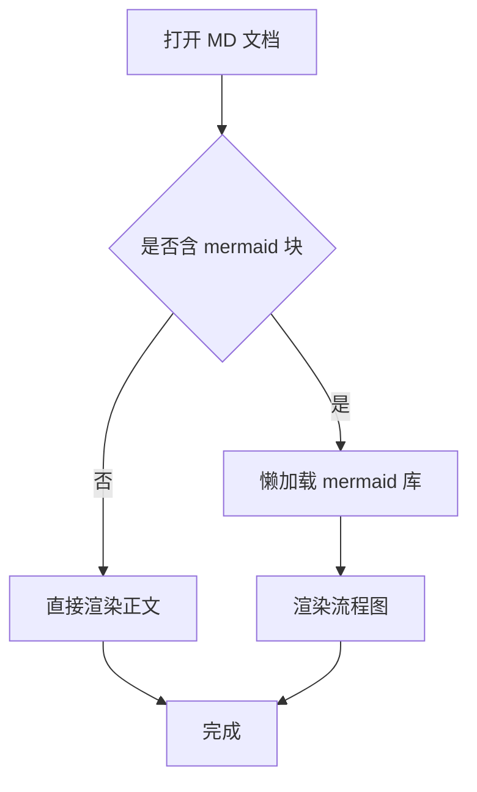
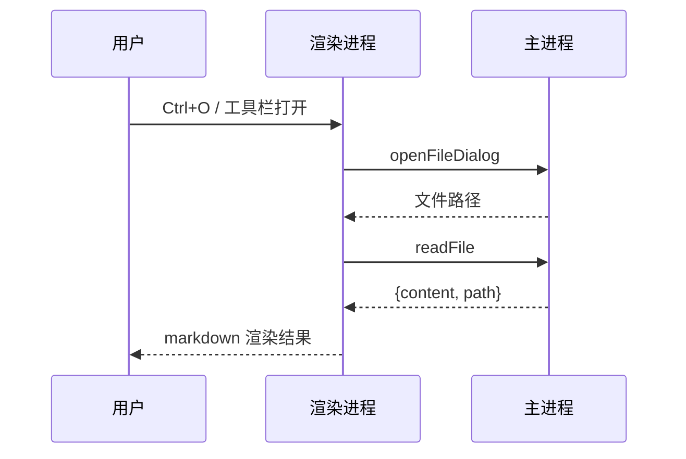

# MDReader 全功能验收文档

> 本文档覆盖当前版本支持的全部渲染能力，每次改动后可用作回归验收。
> 各节标注适用里程碑：M1 基础 / M2-1 高亮 / M2-2 图片。

## 1. 标题层级（M1）

# 一级标题（文档首部已用）

## 二级标题

### 三级标题

#### 四级标题

##### 五级标题

###### 六级标题

## 2. 行内样式（M1）

- **粗体** 与 __粗体__
- *斜体* 与 _斜体_
- ***粗斜体***
- ~~删除线~~
- `行内代码 const answer = 42;`
- 转义测试：\*不是斜体\*、\`不是代码\`、\#\# 不是标题
- 链接：[GitHub 风格链接](https://github.com) 与自动链接 https://example.com
- 原始 HTML 应被转义：<script>alert(1)</script> <b>不是加粗</b>

## 3. 列表（M1）

无序与有序嵌套：

- 第一层
  - 第二层
    - 第三层
- 第二项

1. 有序第一项
2. 有序第二项
   1. 嵌套有序
   2. 嵌套有序

任务列表（M2-6 起渲染为复选框，勾选态只读）：

- [ ] 未完成任务
- [x] 已完成任务
- [ ] 另一项未完成

## 4. 表格（M1）

| 对齐方式 | 左对齐 | 居中 | 右对齐 |
|:---------|:-------|:----:|-------:|
| 默认     | 单元格 | 单元格 | 单元格 |
| 中文列   | 排版   | 检查   | 间距   |

## 5. 引用（M1）

> 一层引用：稳 > 花哨。
>
> > 二层嵌套引用：内网脱机、零依赖、启动效率优先。

## 6. 代码高亮（M2-1）

```javascript
// 关键字/字符串/注释/箭头函数
const sum = (a, b) => a + b;
class Reader {
  constructor(name) { this.name = name; }
}
```

```python
import math

def hypot(a: float, b: float) -> float:
    """直角三角形斜边"""
    return math.sqrt(a * a + b * b)
```

```sql
SELECT id, title FROM documents
WHERE status = 'published' AND deleted_at IS NULL
ORDER BY updated_at DESC
LIMIT 10;
```

```bash
# 启动开发环境
pnpm install
pnpm start
```

未注册语言安全降级：

```notalanguage
plain content ~~not deleted~~ **not bold**
```

## 7. 图片（M2-2）

相对路径（应显示）：


`..` 回溯与中文空格文件名（应显示）：


损坏引用（裂图但不影响后续）：


## 8. 分隔线与排版细节（M1）

---

连字符转换（typographer）：普通 "引号" 与 -- 破折号 -- 与 ... 省略号。

超长行自动换行测试：MMMMMMMMMMMMMMMMMMMMMMMMMMMMMMMMMMMMMMMMMMMMMMMMMMMMMMMMMMMMMMMMMMMMMMMMMMMMMMMMMMMMMMMMMMMMMMMMMMMMMMMMMMMMMMMMMMMMMMMMMMMMMMMMMMMMMM

## 9. 数学公式（M2-3 KaTeX）

行内公式：质能方程 $E = mc^2$ 与勾股定理 $a^2 + b^2 = c^2$。

块级公式（独立成行居中显示）：

$$
\int_0^1 x \, dx = \frac{1}{2}
$$

$$
e^{i\pi} + 1 = 0
$$

带下标与分式的混合：$\sum_{i=1}^{n} i = \frac{n(n+1)}{2}$

超宽公式（M2-6：窗口拉窄时应出现横向滚动条，正文版心不被撑破）：

$$
\int_0^\infty x^2 e^{-x}\,dx + \iint_D f(x,y)\,dA + \oint_\Gamma \mathbf{F}\cdot d\mathbf{r} + \lim_{n\to\infty}\left(1+\frac{1}{n}\right)^n + \frac{d}{dx}\left[\sin x\cos x\tan x\sec x\csc x\cot x\right] + \sum_{k=1}^{\infty}\frac{1}{k^2} + \prod_{p \in \mathbb{P}}\frac{1}{1-p^{-2}} > 0
$$

错误公式应显示红色报错原文而非崩溃：

$$
\fra{1}{2}
$$

### 中文公式（KaTeX 无 CJK 字形，经浏览器字体回退显示）

中文写在 `\text{}` 内（规范写法）：$\text{速度} = \frac{\text{路程}}{\text{时间}}$

块级公式 + 中文注释：

$$
\hat{y} = \beta_0 + \beta_1 x_1 + \beta_2 x_2 + \varepsilon \quad \text{（多元线性回归模型）}
$$

中文与符号混排的条件表达：

$$
f(x) = \begin{cases} x^2, & \text{当 } x \geq 0 \\ -x^2, & \text{当 } x < 0 \end{cases}
$$

全文中文的「伪公式」（应能显示，但正常内容不建议这样写）：

$$
\text{明天会更好}
$$

> 目检要点：中文应全部可见（字体回退到系统字体，与公式西文部分风格略有差异属正常）；若出现方框/豆腐块即为回退失败。


## 10. 流程图（M2-4 Mermaid）

流程图（上→下）：



时序图：



错误图（应显示 mermaid 错误图形/提示而非崩溃）：

```mermaid
graph TD
    A[这行语法故意的
    B --> C
```

---

**验收标准**：以上每一项渲染结果与标注一致；无脚本报错；滚动流畅。
